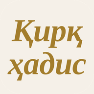

<div align="center">



# «Қирқ ҳадис» — Имом Нававий тўплами

**Имом Нававийнинг «Қирқ ҳадис» китоби — ўзбекча таржимаси билан битта файлли PWA илова**

[**📖 Ўқишни бошлаш → abuyahyo.github.io/qirq-hadis**](https://abuyahyo.github.io/qirq-hadis/)

<sub>42 ҳадис · ўзбекча ва арабча · қидирув · тунги/кундузги мавзу · офлайн</sub>

</div>

---

## ✨ Имкониятлар

### 📖 Мазмун
- **42 ҳадис** — тўлиқ ўзбекча таржима, китоб нашрига аниқ мослаштирилган
- **Араб матни** — тўлиқ ҳаракатлар (диакритика) билан; ҳар ҳадисда «Ўзбекча / Арабча» таблари орқали алмашинади
- **Ровий ва манба** — ҳар ҳадисда ровийи ва манбаси кўрсатилади
- **Муқаддима** — муаллифнинг кириш сўзи (сўзбоши) алоҳида саҳифада

### 🔍 Қидирув
- Ўзбекча матн, сарлавҳа, ровий ва манба бўйича излаш
- Арабча бўйича — ҳаракатларсиз ёзилганча ҳам тапади (араб матни автоматик нормаллаштирилади)
- Топилган жойлар `<mark>` билан белгиланади

### ⌨️ Қулайликлар
- Клавиатура навигацияси: `←`/`→` — олдинги/кейинги ҳадис, `Esc` — бош саҳифа
- Олтин (gold) аксентли тунги/кундузги мавзу
- Пастдаги доимий панел: мавзу тугмаси, бош саҳифага қайтиш ва юқорига скролл
- Хавола билан очиш: `#h/12` — 12-ҳадисга тўғридан-тўғри, улаш мумкин

### 📱 PWA
- Офлайн ишлайди; бош экранга ўрнатилади
- Барча танловлар (мавзу, тил) эсда қолади

---

## 🚀 Ишга тушириш

Бутун илова — битта `index.html` файл: ҳеч қандай қуриш (build) йўқ.

```bash
git clone https://github.com/abuyahyo/qirq-hadis.git
cd qirq-hadis
# index.html браузерда очиш етади,
# ёки статик сервер билан:
python3 -m http.server 8765
# http://127.0.0.1:8765
```

---

## 🗂 Лойиҳа тузилиши

| Файл | Вазифаси |
|------|----------|
| `index.html` | Бутун илова: HTML, CSS, JS ва 42 ҳадис маълумоти бир файлда |
| `manifest.json` | PWA манифести |
| `apple-touch-icon.png`, `icon-192.png`, `icon-512.png` | Иконкалар |
| `tests/` | Синовлар |

### Маълумот тузилиши
```js
QD[i] = {
  id: 1,
  title: "Сарлавҳа",           // ўзбекча сарлавҳа
  narrator: "Ровий исми...",   // ровий
  text: "Ўзбекча таржима...", // таржима матни
  source: "Манба...",          // Бухорий/Муслим
  arabic: "عَنْ ..."          // full diacritics
}
```

---

## 📦 Тарқатиш (Deploy)

`manifest.json` `start_url` ва `scope` repo илдизидан бошланади — исталган статик хостингдан (масалан GitHub Pages) root'dан хизмат қилса PWA тўлиқ ишлайди.

---

## 🤝 Ҳисса қўшиш

Хатолик топсангиз — [Issue](https://github.com/abuyahyo/qirq-hadis/issues) очинг ёки Pull Request юборинг.

---

<div align="center">
<sub>Аллоҳ бу амални қабул қилсин. 🤲</sub>
</div>

---

## 🇬🇧 English

<div align="center">

# Al-Nawawi's Forty Hadith — Uzbek Reader

A single-file PWA with all 42 hadiths of Imam al-Nawawi's collection in Uzbek translation, matched verbatim to the printed edition, alongside the fully vocalized Arabic originals.

</div>

### Features
- **42 hadiths** with Uzbek translation, full Arabic text with diacritics, narrator and source
- **Uzbek / Arabic tabs** switch the displayed text per hadith
- **Search** across translation, titles, narrators and sources; Arabic matching tolerates missing diacritics; matches highlighted
- **Routing & keyboard**: deep links via `#h/12`, prev/next with arrow keys, `Esc` back home
- **Gold-accented dark/light theme**, remembered between visits
- **PWA**: installable, works offline

### Usage
Everything lives in one `index.html` — no build step:

```bash
git clone https://github.com/abuyahyo/qirq-hadis.git
cd qirq-hadis
python3 -m http.server 8765   # or just open index.html
```

Readings data: `const QD = [...]` inside `index.html` — `{ id, title, narrator, text, source, arabic }`.
